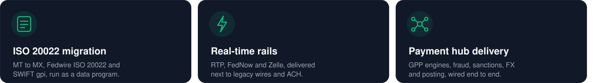
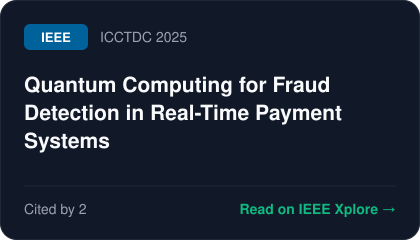
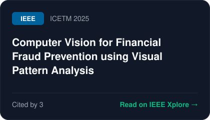
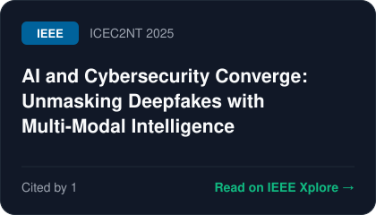
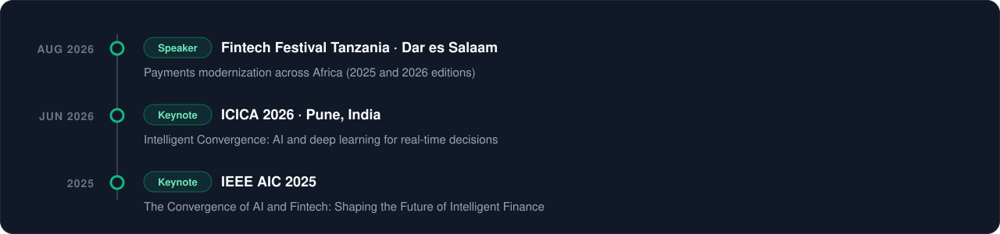
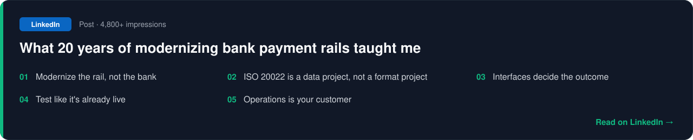

  

  
  
  
  

 

I've spent **20+ years taking payment platforms live inside tier-1 banks**, including PNC, Bank of America, Citibank and Shinsei Bank. Today I help U.S. banks move off legacy payment systems onto cloud-native ISO 20022 platforms, one rail at a time, with old and new running side by side.

### What I focus on

### How an instant payment moves

### Open-source projects

  
  
  
  

### Research

  
  
  

All publications on my <a href="https://ieeexplore.ieee.org/author/383776824844004">IEEE Xplore author page</a>.

### Recent talks

### Writing

### Toolbox

### Credentials

