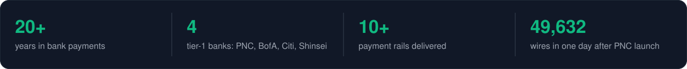
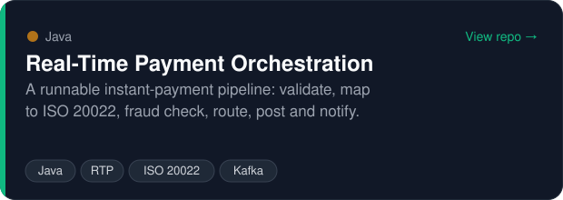
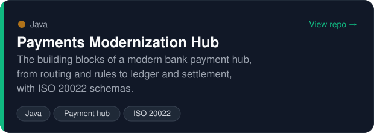
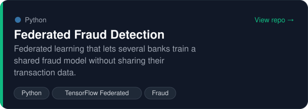
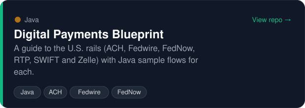

  

  <a href="https://rahulautade2288.github.io/">Website</a> &nbsp;·&nbsp;
  <a href="https://www.linkedin.com/in/rahul-autade/">LinkedIn</a> &nbsp;·&nbsp;
  <a href="https://rahulautade2288.github.io/talks.html">Talks</a> &nbsp;·&nbsp;
  <a href="mailto:rahulautade2287@gmail.com">Email</a>

### About

I've spent 20+ years taking payment platforms live inside tier-1 banks, including PNC, Bank of America, Citibank and Shinsei Bank. Today I help U.S. banks move off legacy payment systems onto cloud-native ISO 20022 platforms, one rail at a time, with old and new running side by side.

  

**What I work on:** ISO 20022 migrations · Global PAYplus (GPP) delivery · payment hub architecture · bank and partner integrations · implementation planning and cutover

### Open-source projects

  
  
  
  

### Recent talks

- **Keynote, ICICA 2026** · Intelligent Convergence: AI and Deep Learning for Real-Time Decision Intelligence
- **Keynote, AIC 2025** · [The Convergence of AI and Fintech: Shaping the Future of Intelligent Finance](https://scrs.in/conference/aic2025/speaker/talk/1035)
- **Speaker, Fintech Festival Tanzania** · 2025 and 2026, Dar es Salaam

More on my <a href="https://rahulautade2288.github.io/talks.html">talks page</a>.

### Toolbox

`Java` `Spring Boot` `Kafka` `Python` `TypeScript` `Azure` `DataStax` `Solr` `Keycloak` `Camunda / BPMN 2.0` `GitHub Actions` `Postman` `Jira`

IEEE Senior Member · Sigma Xi Full Member
